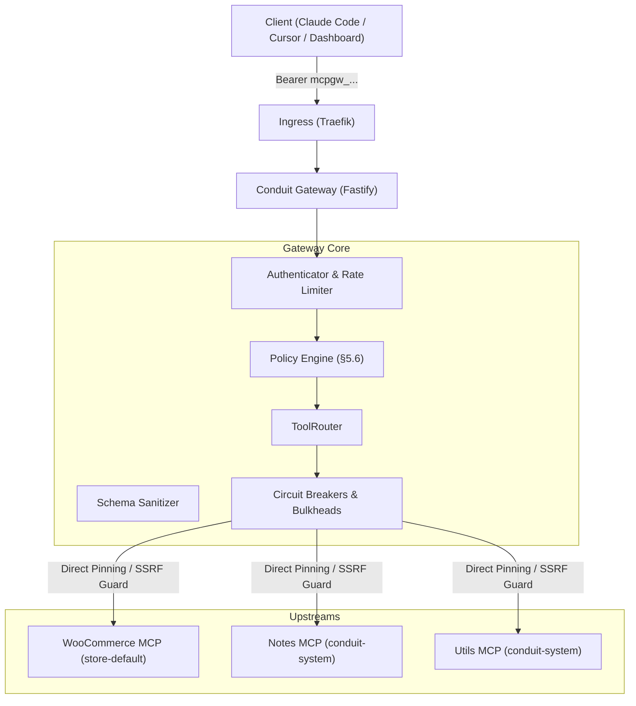

# Conduit — System Design & Architecture Document

This document outlines the architectural decisions, aggregation and routing topologies, failure-handling mechanisms, and production-readiness enhancements governing Conduit.

---

## 1. Core Architecture Choices

### 1.1 Fastify & TypeScript Ecosystem
- **Rationale**: Fastify was selected over Express or NestJS due to its low overhead, native async/await architecture, robust plugin model, and built-in schema serialization.
- **Strict Typing**: TypeScript in strict mode runs end-to-end across the monorepo (`packages/shared`, `apps/gateway`, `apps/dashboard`, `apps/woo-mcp`, `apps/notes-mcp`, `apps/utils-mcp`). Shared Zod schemas define all data transfer objects (DTOs), eliminating schema divergence between frontend and backend.

### 1.2 Streamable HTTP MCP Front Door vs. Stdio
- **The Problem with Stdio Subprocesses**: Standard MCP tools run as local processes on developer workstations (`stdio`). In team environments, this forces every engineer to configure and store raw database credentials, WooCommerce consumer keys, and API tokens locally.
- **The Conduit Solution**: Conduit acts as a unified HTTP front door (`http://gateway.localhost/mcp`). 
  - Supports standard JSON-RPC 2.0 HTTP POST calls and Server-Sent Events (SSE) streaming streams.
  - Team members configure their local IDEs (Claude Code, Cursor, MCP Inspector) with a single Bearer token (`mcpgw_...`).
  - Upstream credentials remain securely enclosed within Kubernetes Secrets and process memory.

### 1.3 MongoDB StatefulSet for Dynamic Schema Persistence
- **Dynamic Tool Definitions**: Upstream MCP servers emit arbitrary JSON schemas for tool arguments and return open-ended payloads. MongoDB's flexible document model natively stores these schemas without complex schema migrations.
- **Atomic Operations & TTL Retention**:
  - Audit logs utilize native MongoDB TTL indexes (1-year retention) for automated compliance without manual cleanup cron jobs.
  - State machines (tool approval transitions, server status updates, session tracking) leverage atomic `findOneAndUpdate` queries.
  - Migration runner (`apps/gateway/src/db/migrator.ts`) executes versioned, idempotent migrations at startup before any HTTP routes bind.

---

## 2. Aggregation, Routing & Failure Handling

### 2.1 Dynamic Namespace Aggregation (`ToolRouter`)
- **Prefixing Strategy**: Upstream tools are dynamically aggregated and namespaced using the server's slug: `<slug>__<tool_name>` (e.g. `woo__list_orders`, `notes__notes_create`, `utils__utils_calculate`).
- **Collision Immunity**: Name collisions across independent upstream servers are impossible.
- **Two-Stage Approval State Machine**:
  - `pending`: Newly discovered tools are quarantined. Invisible to members until an admin explicitly reviews and approves them.
  - `approved`: Active and callable by permitted users.
  - `changed`: If an upstream modifies an existing tool's description or input schema, the tool flips to `changed`, immediately revoking member access until re-approved.

### 2.2 Failure Isolation & Circuit Breaker Architecture
- **Per-Upstream Bulkhead**: Each upstream connection maintains independent concurrency limits and HTTP client instances. A slow or hanging upstream cannot exhaust Node.js sockets or degrade unrelated upstreams.
- **Circuit Breaker State Machine**:
  - **Closed**: Normal operations. Upstream calls proceed.
  - **Open**: Triggered after consecutive failures (HTTP 5xx, timeouts, network errors). Calls fail immediately with an informative `"Upstream Unavailable"` error without dialing the upstream, preventing cascading socket exhaustion.
  - **Half-Open**: After a configurable cooldown reset timeout, canary probes test upstream recovery. Successful calls transition the circuit back to `Closed`.
- **Status Reporting**: Upstreams report real-time health (`healthy`, `degraded`, `unreachable`) to the dashboard, accompanied by exact error diagnostics.

---

## 3. Production Readiness Overhaul (Phase 8)

### 3.1 Least-Privilege Database Security
- The MongoDB application user (`conduit`) is strictly restricted to `readWrite` on the `conduit` database. Administrative and cross-database privileges (`readWriteAnyDatabase`, `dbAdminAnyDatabase`) are completely eliminated.
- Automated tests run against ephemeral throwaway MongoDB containers in Docker, ensuring zero test data touches the cluster.

### 3.2 Full SSRF Defense Guard
- Custom Undici HTTP agent resolves hostnames prior to socket creation.
- Strict RFC/Bogon filtering blocks loopback (`127.0.0.0/8`, `::1`), link-local/cloud metadata (`169.254.169.254`, `fe80::/10`), private networks (`10.0.0.0/8`, `172.16.0.0/12`, `192.168.0.0/16`), CGNAT, and multicast.
- Connects directly to validated IP addresses with pre-configured `Host` headers to neutralize DNS rebinding TOCTOU attacks.
- Configurable Helm allowlist permits only explicit in-cluster microservices (`*.conduit-system.svc.cluster.local`, `*.store-default.svc.cluster.local`).

### 3.3 Fine-Grained Policy Engine (§5.6)
- Deterministic permission resolution hierarchy: `User Deny` > `User Allow` > `Role Deny` > `Role Allow` > `Members Read-Only Shortcut` > `Default Allow`.
- Complete suppression of forbidden tools from discovery (`tools/list`) and invocation (`tools/call`), returning an identical `"Unknown tool"` response to defeat API enumeration attacks.

### 3.4 Key Rotation & Cryptographic Agility
- Credentials at rest utilize AES-256-GCM authenticated encryption tagged with dynamic Key Identifiers (`kid`).
- Multi-key configuration supports zero-downtime key rotation via `dev/rotate-credentials.ts`.
- Member API keys are hashed with HMAC-SHA256 using a server-side pepper (`API_KEY_PEPPER`).
